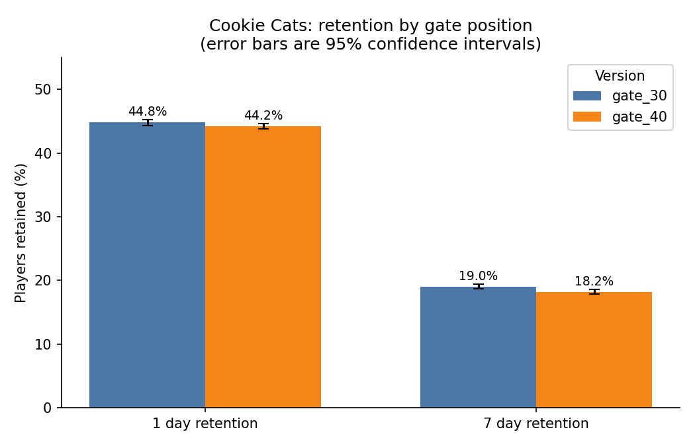

# Cookie Cats A/B Test: Does Gate Position Affect Player Retention?

## Overview

This is a practice data analysis project using the public Cookie Cats mobile game dataset.

I investigated whether moving the game's first progression gate from level 30 to level 40 affected player retention.

The analysis covers data quality, statistical hypothesis testing, confidence intervals, bootstrap resampling, multiple-testing correction, and power analysis.

This is an independent learning project, not published research or production A/B testing experience.

## Key Findings

- The dataset contains 90,189 players.
- Day 1 retention was 44.82% for gate_30 and 44.23%  for gate_40. The difference was not statistically  significant.
- Day 7 retention was 19.02% for gate_30 and 18.20%  for gate_40.
- The Day 7 difference was statistically significant  (Holm-adjusted p = 0.0031).
- Game-round analysis did not show convincing evidence  of improved player activity.
- A statistically significant sample-ratio mismatch  requires investigation before drawing strong causal  conclusions.

## Conclusion

The results suggest that moving the gate to level 40 may reduce 7-day player retention without improving average game rounds.

However, the sample-ratio mismatch prevents an unqualified causal conclusion.

The analysis is exploratory, and the findings should be interpreted with these limitations in mind.

## Retention Comparison

## Data

- 90,189 players, one row per player, five columns: `userid`, `version`, `sum_gamerounds`, `retention_1`, `retention_7`.
- `sum_gamerounds` is the number of rounds played in the first week after install. `retention_1` and `retention_7` say whether the player played again 1 day and 7 days after install. These descriptions come from a secondary source (https://virtualworldseconomies.substack.com/p/ab-testing-cookie-cats-mobile-game), which also says players were randomly assigned at installation.
- Where it came from: that same page says the dataset originally comes from DataCamp and was published on Kaggle. I could not confirm the original publisher or the licence, so I do not include the data file in this repository.
- The copy I used was downloaded on 22 October 2026 from a GitHub repository that hosts it: https://raw.githubusercontent.com/ryanschaub/Mobile-Games-A-B-Testing-with-Cookie-Cats/master/cookie_cats.csv
- SHA256 of my copy: `5ab54d761fbddcd50de7b88e4eaf7837cba4569474f50c043a4d17ee342c46bd`. If your copy gives a different value, the numbers below may differ.

## Software

Python 3.11.15, pandas 3.0.2, numpy 2.4.4, scipy 1.17.1, statsmodels 0.15.0, matplotlib 3.10.9.

## Method

1. Data checks: missing values, duplicate player IDs, group sizes, and a sample ratio check (chi square test of the group sizes against an even 50/50 split).
2. Compared the two groups on 1 day retention and 7 day retention with a two proportion z test (treatment minus control). Reported the difference in percentage points (pp) with a 95% confidence interval (Newcombe method) and a second interval from a bootstrap with 5,000 resamples and a fixed random seed.
3. Because I tested two retention metrics, I adjusted the p values with the Holm method.
4. Looked at game rounds separately, using the Mann Whitney U test, a Welch t test, and a version of the t test after removing the single largest value.
5. Power analysis: the smallest difference this sample could detect with 80% power at the 5% level, and the sample size needed to detect a difference of 1 pp in 7 day retention.
6. I checked the main 7 day z statistic a second time by hand with the pooled proportion formula, without statsmodels, and got the same value (z = -3.16).

### A choice I should be open about

I treated 7 day retention as the main metric because it looks further ahead than 1 day retention. However, I had already looked at the group averages when I chose it, so this was not a plan fixed before seeing the data. I report both retention metrics with the adjustment above so the choice does not drive the conclusion.

## Results

| Metric | gate_30 (n = 44,700) | gate_40 (n = 45,489) | Difference | 95% CI for difference | Holm adjusted p value |
|---|---|---|---|---|---|
| 1 day retention | 44.82% | 44.23% | -0.59 pp | -1.24 to +0.06 pp | 0.0744 |
| 7 day retention | 19.02% | 18.20% | -0.82 pp | -1.33 to -0.31 pp | 0.0031 |

Bootstrap intervals agree with the table: -1.23 to +0.05 pp for 1 day and -1.32 to -0.31 pp for 7 day retention.

What I take from this:

- 7 day retention was lower with the gate at level 40, by about 0.8 percentage points, which is about 4.3% lower in relative terms. The interval does not include zero.
- For 1 day retention the difference was smaller (about 0.6 pp lower) and the interval includes zero. That does not show there is no effect, it only means this test could not separate it from chance.
- Game rounds: mean 52.46 (gate_30) versus 51.30 (gate_40), median 17 versus 16. The Mann Whitney test gave p = 0.0502, which is borderline and I do not read it as a clear result. The Welch t test on raw rounds gave p = 0.376, but one player in `gate_30` has 49,854 rounds, far above the next largest value of 2,961. After removing that player the means are 51.34 and 51.30 (p = 0.95). So the raw mean difference came almost entirely from one extreme player.
- Power: with about 45,000 players per group, the test could detect a difference of about 0.74 pp in 7 day retention and about 0.93 pp in 1 day retention with 80% power. The 1 day difference I observed (0.59 pp) is smaller than that, so it is not surprising that it was not significant. To detect a 1 pp change in 7 day retention, about 23,685 players per group are needed.

Full output is in `results/results.txt`, the numbers are in `results/retention_results.csv` and the chart is `results/retention_chart.png`.

## Limitations

- **The group sizes do not match an even split.** There are 44,700 players in `gate_30` and 45,489 in `gate_40`. For an exact 50/50 assignment, the chance of a gap this large is about 0.9% (chi square = 6.90, p = 0.0086). This does not prove a problem, and I do not know from the data how players were assigned. In a real job I would ask how assignment and logging worked before trusting the result, because an unexplained imbalance can mean the two groups are not comparable. The conclusions above hold only if the randomisation was sound.
- The data covers the first week only. I cannot say anything about longer retention, spending or advertising revenue.
- A difference being statistically clear does not tell me whether 0.8 pp matters to the business. That depends on what a retained player is worth, which this dataset does not contain.
- No information about players (device, country, source) is available, so I could not check whether the effect differs between groups of players.
- I looked at two retention metrics and a game rounds comparison. The Holm adjustment covers the two retention tests only.
- This analysis does not explain why the gate position changes retention. The data cannot show the mechanism.

## How to run

1. Download the dataset from the link above.
2. `pip install -r requirements.txt`
3. `python ab_test_analysis.py path/to/cookie_cats.csv`

The script writes its output to a `results` folder.

## Files

- `ab_test_analysis.py`: the full analysis
- `requirements.txt`: package versions I used
- `results/results.txt`: printed output
- `results/retention_results.csv`: retention results table
- `results/retention_chart.png`: retention by version with 95% confidence intervals

## Author

Adebayo A. Adeniyi, October 2026
